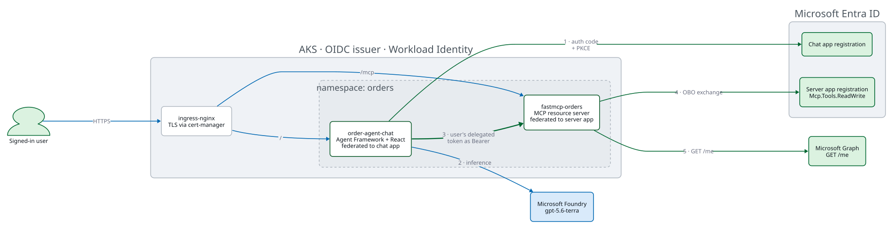

# Delegated identity for MCP servers on Azure

An MCP server where every tool call runs as the person who asked — not as the
service. No secrets anywhere, and no application-permission path to user data.

Deployed with one `azd up` onto AKS, with a Microsoft Agent Framework chat app
in front of it.

## Pick a mode

The two are alternatives, not layers. Each is a complete example; you deploy one.

| | **orders** | **databricks** |
|---|---|---|
| For | Building your own MCP server on Azure | Reaching a governed data platform as the caller |
| Downstream | Microsoft Graph | Azure Databricks + Unity Catalog |
| Who authorizes | Your code, by the object id Graph returned | Unity Catalog row filters, column masks and grants |
| Extra infrastructure | None | A premium Databricks workspace |
| Read next | [orders mode](docs/orders-mode.md) | [databricks mode](docs/databricks-mode.md) |

The identity path is **identical** in both. The only difference is which scope
the on-behalf-of exchange asks Entra for:

```
orders      scope = https://graph.microsoft.com/.default
databricks  scope = 2ff814a6-3304-4ab8-85cb-cd0e6f879c1d/.default
```

That is `src/obo.py`, about twenty lines, shared by both.

## The one idea

The chat app authenticates the user and holds their delegated token. Every MCP
call carries that token. The MCP server verifies it, then exchanges it — along
with its own pod identity — for a token to a downstream resource that **still
carries the user**.

Neither workload can reach user data on its own. The MCP server holds only
delegated permissions, and a delegated permission is inert without a caller.

**[How the authorization actually works](docs/authorization.md)** explains this
properly: the three identities, the three gates, and why Microsoft Graph is not
the authorization system. Read it once and the rest of the repo follows.

## What runs where



Green edges carry or establish a user identity. Blue edges do not — which is why
the arrow to Foundry is blue and the arrow between the two pods is green.

## Prerequisites

- Azure subscription Owner, or Contributor plus User Access Administrator.
- An Entra **Application Administrator**, Cloud Application Administrator,
  Privileged Role Administrator, or Global Administrator role, active. Directory
  roles travel inside the access token, so sign in again after activating one.
- At least 100K available Global Standard quota for `gpt-5.6-terra`.
- Azure CLI, Azure Developer CLI, `uv`, `kubectl`, `kubelogin`, and Helm 3.
- macOS, Linux, or WSL for the POSIX `azd` hooks.

No local Docker daemon, and no Databricks account administrator. Node.js 22 is
needed only when changing the frontend; ACR builds it remotely.

## Deploy

```bash
az login --tenant <tenant-id>
azd auth login --tenant-id <tenant-id>

azd env new demo
azd env set AZURE_SUBSCRIPTION_ID <subscription-id>
azd env set AZURE_LOCATION northeurope
azd env set MCP_MODE orders          # or: databricks
azd up
```

`azd up` provisions Foundry, the model, both app registrations, AKS, ACR,
networking, both images, the Helm dependencies and both workloads. In databricks
mode it also provisions the workspace and runs the Unity Catalog bootstrap.

Then open it:

```bash
azd env get-value APP_URL
```

Sign in and ask, depending on your mode:

```text
What orders do I have?
Prove which identity the MCP server resolved for me.
```

## Verify it

```bash
uv run python -m unittest test_accelerator -v    # no deployment needed
uv run python -m unittest test_databricks_e2e -v # databricks mode, live
```

`test_accelerator` is named explicitly on purpose — bare `python -m unittest`
also discovers the end-to-end module, which calls the deployed stack.

## Source layout

| Path | Purpose |
|---|---|
| `src/obo.py` | The on-behalf-of exchange. Both modes call it; only `scope` differs |
| `src/server.py` | Token verification, and the mode switch |
| `src/orders.py` | orders mode: Graph OBO, authorization in the application |
| `src/databricks.py` | databricks mode: Databricks OBO, authorization in Unity Catalog |
| `src/chat.py` | Web login, safe session API, Agent Framework, delegated MCP calls |
| `scripts/bootstrap_databricks.py` | The Unity Catalog objects Bicep cannot create |
| `infra/main.bicep` | Azure, Foundry, Entra, consent, federation, and RBAC |
| `frontend/` | Vite React application with local shadcn UI |
| `k8s/` | Deployments, Services, issuer, and the shared Ingress |
| `test_accelerator.py` | Unit tests, no deployment needed |
| `test_databricks_e2e.py` | End-to-end proof against a live deployment |
| `docs/*.d2` | Diagram sources; the SVGs are committed alongside |

To follow the identity path in code, read the module docstring at the top of
`src/chat.py`, then `src/server.py`, then `src/obo.py`. Between them they
describe every token in the diagrams.

After editing a `.d2` file, re-render it:

```bash
for name in architecture token-flow trust-boundaries databricks-obo; do
  d2 "docs/$name.d2" "docs/$name.svg"
done
```

## Deliberate limits

- One replica for each workload; in-memory web sessions reset when pods restart.
- orders mode keeps orders in memory; they reset with the pod.
- databricks mode uses Databricks Default Storage and one 2X-Small SQL warehouse
  with a ten-minute auto-stop, so the first query after an idle period waits for
  it to start. Demo tables are dropped and reseeded on every bootstrap run.
- Public demo DNS through the public IP's `cloudapp.azure.com` label.
- No database, Redis, Key Vault, custom domain, private network, or telemetry.

`azd deploy` rewrites the `images:` block of both `k8s/*/kustomization.yaml`
files with the tag it just built, so those two files show as modified after
every deployment. That is expected and does not need committing.

## Clean up

```bash
azd down
```

The resource group holds the billable AKS, ACR, public IP, Foundry resource,
project, model deployment, and — in databricks mode — the workspace. `azd down`
does not remove Unity Catalog objects, which live in the metastore rather than
the resource group. Microsoft Graph application objects are tenant-scoped and
can outlive the resource group; remove the two generated app registrations if
`azd down` leaves them.

## Troubleshooting

**Bicep cannot create an app or permission grant** — activate an Entra
application-management role, run `az login` again to pick it up, and retry.

**The model deployment reports insufficient quota** — check the
`OpenAI.GlobalStandard.gpt-5.6-terra` quota in Sweden Central. The template
requests capacity 100.

**AKS deployment is forbidden** — `kubectl auth can-i create deployments.apps
--all-namespaces`. The deploying user needs Azure Kubernetes Service RBAC
Cluster Admin; Bicep assigns it, but propagation takes a few minutes.

**The certificate stays pending** — `kubectl describe certificate order-agent-tls
-n orders`, then `kubectl logs -n cert-manager deployment/cert-manager`.

**Chat works but tools fail** — `kubectl logs -n orders deployment/order-agent-chat`
and `kubectl logs -n orders deployment/fastmcp-orders`. Check both service
accounts carry the expected Workload Identity annotations.

Databricks-specific failures are in [databricks mode](docs/databricks-mode.md).

## References

- [Microsoft identity platform OAuth 2.0 On-Behalf-Of flow](https://learn.microsoft.com/entra/identity-platform/v2-oauth2-on-behalf-of-flow)
- [Microsoft Agent Framework with Microsoft Foundry](https://learn.microsoft.com/agent-framework/agents/providers/microsoft-foundry)
- [Azure Developer CLI Helm and Kustomize support](https://learn.microsoft.com/azure/developer/azure-developer-cli/helm-kustomize-support)
- [Row filters and column masks in Unity Catalog](https://learn.microsoft.com/azure/databricks/data-governance/unity-catalog/filters-and-masks/)
