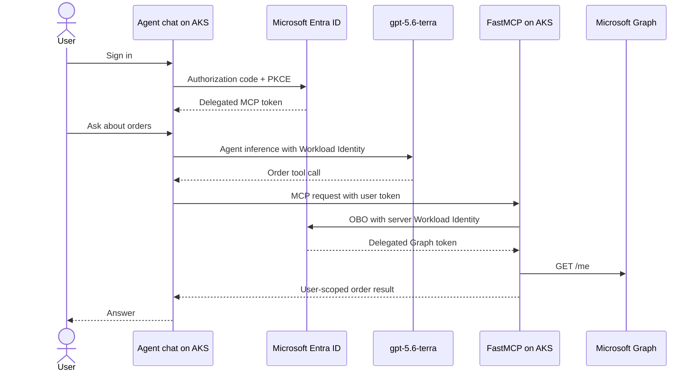

# Order agent with delegated MCP OBO on AKS

A two-workload Python sample deployed with one `azd up`:

- A Microsoft Agent Framework chat application authenticates the user.
- A React and TypeScript interface built from shadcn conversation primitives
  presents the live identity path and chat.
- Agent text streams as it is generated, while collapsible shadcn tool cards
  show sanitized MCP inputs, completion state, and results.
- A separate FastMCP server provides user-scoped order tools.
- The agent uses a Microsoft Foundry `gpt-5.6-terra` deployment.
- Every MCP call carries the signed-in user's delegated token.
- The MCP server exchanges that token for Microsoft Graph access through OBO.

The chat workload never uses application permissions to call the MCP server.
Its AKS identity is used only for Foundry inference and as the confidential
client assertion during the authorization code flow.



## What `azd up` creates

- One-node Free-tier AKS with Entra integration, Azure RBAC, OIDC, and Workload
  Identity.
- Basic ACR with admin and anonymous access disabled.
- A static public IP, Azure DNS label, ingress-nginx, cert-manager, and a trusted
  endpoint.
- A Microsoft Foundry resource and project in Sweden Central.
- `gpt-5.6-terra` version `2026-07-09`, Global Standard capacity `100`.
- Separate Entra registrations and federated credentials for the chat client and
  MCP server.
- Declarative tenant-wide consent for delegated `Mcp.Tools.ReadWrite` and Graph
  `User.Read`.
- Separate non-root chat and MCP Deployments in the `orders` namespace.

The Azure resources and Entra configuration are Bicep. `azd` builds both images
with ACR remote builds and deploys the workloads with Kustomize. A short
`predeploy` hook installs pinned ingress-nginx and cert-manager Helm charts.
There is no custom deployment program.

## MCP tools

| Tool | Behavior |
|---|---|
| `who_am_i` | Shows the safe Graph `/me` identity proof resolved through OBO |
| `list_orders` | Lists orders owned by the signed-in user |
| `get_order` | Gets one owned order |
| `create_order` | Creates a validated order |
| `update_order_status` | Applies a valid status transition |

Orders move through `pending -> processing -> shipped -> delivered`. Pending or
processing orders can be cancelled. Repeating the current status is idempotent.

## Prerequisites

- Azure subscription Owner, or Contributor plus User Access Administrator.
- An active Entra Application Administrator, Cloud Application Administrator,
  Privileged Role Administrator, or Global Administrator role.
- At least 100K available Global Standard quota for `gpt-5.6-terra`.
- Azure CLI, Azure Developer CLI, `uv`, `kubectl`, `kubelogin`, and Helm 3.
- macOS, Linux, or WSL for the POSIX `azd` hooks.

No local Docker daemon is required. Node.js 22 is needed only when changing or
validating the frontend locally; ACR builds it remotely during `azd up`.

## Deploy

For an external tenant, authenticate both CLIs against that tenant:

```bash
az login --tenant <tenant-id>
azd auth login --tenant-id <tenant-id>
az account set --subscription <subscription-id>
```

Create the environment and deploy:

```bash
azd env new demo
azd env set AZURE_SUBSCRIPTION_ID <subscription-id>
azd env set AZURE_LOCATION northeurope
azd up
```

`azd up` provisions Foundry, the model, identity, AKS, ACR, networking, both
images, Helm dependencies, and both workloads.

Open the deployed chat URL:

```bash
azd env get-value APP_URL
```

Sign in, then try:

```text
What orders do I have?
Prove which Graph identity the MCP server resolved for me.
Create an order for two DEMO-001 items at 1299 cents each.
Move that order to processing.
```

The identity proof contains the Graph display name, an eight-character hash of
the Graph object ID, and the evidence label `Microsoft Graph /me via OBO`. It
never returns the raw Graph ID, token, or claims.

## Demonstrate user isolation

Keep the single MCP pod running for the whole demonstration because the sample
store is in memory.

1. Sign in as user A and create an order.
2. Ask the agent to prove the MCP identity. Record user A's display name and
   fingerprint from the `Who Am I` tool card.
3. Open an InPrivate window and sign in as user B.
4. List orders. User A's order is absent.
5. Request user A's known order ID directly. The result is `Order not found`,
   which does not disclose whether another user owns that ID.
6. Ask for the identity proof again. User B has a different Graph display name
   and fingerprint.
7. Create an order as user B, then return to user A and list orders again. Each
   user sees only their own data.

The server partitions `_orders` by the object ID returned from Graph `/me`.
Application-only calls remain rejected because the MCP requires the delegated
`Mcp.Tools.ReadWrite` scope and Graph `/me` requires user context.

Important outputs:

| Value | Purpose |
|---|---|
| `APP_URL` | Hosted chat application |
| `MCP_ENDPOINT` | Protected Streamable HTTP MCP endpoint |
| `MCP_SCOPE` | Delegated scope requested by the chat client |
| `FOUNDRY_PROJECT_ENDPOINT` | Agent Framework project endpoint |
| `FOUNDRY_MODEL_DEPLOYMENT_NAME` | Model deployment used by the agent |
| `ENTRA_CLIENT_CLIENT_ID` | Chat web application ID |
| `ENTRA_SERVER_CLIENT_ID` | MCP resource application ID |

## Source layout

| Path | Purpose |
|---|---|
| `src/chat.py` | Web login, safe session API, static hosting, Agent Framework, and delegated MCP calls |
| `src/server.py` | FastMCP order tools and Graph OBO |
| `frontend/` | Vite React application with local shadcn UI and chat components |
| `Dockerfile.chat` | Multi-stage frontend and locked Python chat image |
| `infra/main.bicep` | Azure, Foundry, Entra, consent, federation, and RBAC |
| `k8s/chat/` | Chat Deployment, Service, issuer, and shared Ingress |
| `k8s/mcp/` | MCP Deployment and Service |
| `azure.yaml` | ACR builds, Kustomize deployment, and Helm installation |

## Local checks

```bash
uv sync --frozen
cd frontend && npm ci && npm run build && npm run lint && cd ..
uv run python -m unittest -v
uv run python -m compileall -q src test_accelerator.py
az bicep build --file infra/main.bicep --stdout > /dev/null
azd provision --preview --no-prompt
```

## Troubleshooting

**Bicep cannot create an app or permission grant**

Activate an Entra application-management role, refresh the Azure CLI login, and
run `azd up` again.

**The model deployment reports insufficient quota**

Check the `OpenAI.GlobalStandard.gpt-5.6-terra` quota in Sweden Central. The
template requests capacity 100.

**AKS deployment is forbidden**

```bash
kubectl auth can-i create deployments.apps --all-namespaces
```

The deploying user needs Azure Kubernetes Service RBAC Cluster Admin on the
cluster. Bicep assigns it, but propagation can take several minutes.

**The certificate remains pending**

```bash
kubectl describe certificate order-agent-tls -n orders
kubectl get orders,challenges -A
kubectl logs -n cert-manager deployment/cert-manager
```

**Chat works but order tools fail**

```bash
kubectl logs -n orders deployment/order-agent-chat
kubectl logs -n orders deployment/fastmcp-orders
```

Verify that the chat pod uses `order-agent-chat`, the MCP pod uses
`fastmcp-orders`, and both service accounts contain the expected Workload
Identity annotations.

## Clean up

```bash
azd down
```

The resource group contains the billable AKS, ACR, public IP, Foundry resource,
project, and model deployment. Microsoft Graph application objects are
tenant-scoped and can outlive the resource group; remove the two generated app
registrations if `azd down` does not delete them.

## Deliberate limits

- One replica for each workload.
- In-memory orders and web sessions reset when their pods restart.
- Browser-side chat display with server-side Agent Framework session state.
- Public demo DNS through the public IP's `northeurope.cloudapp.azure.com` label.
- No database, Redis, Key Vault, custom domain, private network, or telemetry
  stack.

References:

- [Microsoft Agent Framework with Microsoft Foundry](https://learn.microsoft.com/agent-framework/agents/providers/microsoft-foundry)
- [Azure Developer CLI Helm and Kustomize support](https://learn.microsoft.com/azure/developer/azure-developer-cli/helm-kustomize-support)
- [Remote MCP OBO reference](https://learn.microsoft.com/azure/developer/azure-mcp-server/how-to/deploy-remote-mcp-server-on-behalf-of)
