# Order agent with delegated MCP OBO on AKS

A two-workload Python sample deployed with one `azd up`:

- A Microsoft Agent Framework chat application authenticates the user.
- A React and TypeScript interface built from shadcn conversation primitives
  presents the live identity path and chat.
- Agent text streams as it is generated, while collapsible shadcn tool cards
  show sanitized MCP inputs, completion state, and results.
- A separate FastMCP server provides user-scoped order tools.
- The agent uses a Microsoft Foundry `gpt-5.6-terra` deployment.
- Every MCP call carries the signed-in user's delegated token.
- The MCP server exchanges that token for Microsoft Graph access through OBO.
- The same token also reaches Azure Databricks, where Unity Catalog — not this
  code — decides which rows and columns the caller may see.

The chat workload never uses application permissions to call the MCP server.
Its AKS identity is used only for Foundry inference and as the confidential
client assertion during the authorization code flow.

## What runs where


Green edges carry or establish a user identity. Blue edges do not — which is
why the arrow to Foundry is blue and the arrow between the two pods is green.

## How a question becomes an answer


## The three identities

Almost everything else in this repo is scaffolding. Keeping these three apart is
the pattern:

| Identity | Where it lives | What it may do |
|---|---|---|
| Signed-in user | A delegated token in the chat pod's per-session MSAL cache | Call the MCP server, and through OBO read their own Graph profile |
| Chat workload | AKS Workload Identity federated to the chat app registration | Sign the client assertion during the code flow, and call Foundry for inference. It holds no permission on the MCP server |
| MCP workload | AKS Workload Identity federated to the server app registration | Prove which service it is during the OBO exchange. It holds no standing permission to read anyone's data |

Because the MCP workload has only delegated Graph permission, it cannot resolve
a user until that user's token arrives. There is no application-only path to
`/me`, and therefore none to the orders keyed by it.



## The same token, a second resource

The order tools partition an in-memory dict by Graph object id. That is correct
only for as long as every tool remembers to do it, and a single forgotten filter
is a data leak. The Databricks tools show the alternative: hand the caller's
identity to a system that already knows how to authorize it, and stop being the
authorization layer.


Only two things differ between the two paths:

| | Microsoft Graph | Azure Databricks |
|---|---|---|
| OBO scope | `https://graph.microsoft.com/.default` | `2ff814a6-…-cd0e6f879c1d/.default` |
| Who decides what you see | `src/server.py`, by hand | Unity Catalog row filter, column mask, and grants |

`src/obo.py` holds the exchange both share. Swapping the `scope` argument is the
whole difference; the workload assertion, the user assertion, and the absence of
a stored credential are identical.

The `2ff814a6-3304-4ab8-85cb-cd0e6f879c1d` app id is an Azure constant, the same
in every tenant, and `user_impersonation` is its only delegated permission.
`infra/main.bicep` requests exactly that one scope as a delegated `Scope` and
never as an application `Role`, so the MCP workload has no path to Databricks
that works without a caller. A test asserts that the template contains no
application permission at all.

### What Unity Catalog enforces

The bootstrap seeds nine orders and gives three of them to the deploying user,
then attaches a row filter and a column mask:

```sql
CREATE FUNCTION orders_row_filter(owner STRING)
RETURNS BOOLEAN RETURN owner = current_user();

ALTER TABLE orders SET ROW FILTER orders_row_filter ON (owner_email);
ALTER TABLE orders ALTER COLUMN customer_email SET MASK mask_email;
```

The MCP server sends `SELECT … FROM orders` with no predicate on `owner_email`.
Three rows come back, with `customer_email` reading `***@northwind.example`. The
server filtered nothing — it never received the other six rows.

Worth knowing: this holds **even for the table owner and a metastore admin**.
Table-level row filters and column masks have no owner bypass, unlike dynamic
views, where the owner sees everything. The demonstration is therefore honest
when the person running it is an administrator, which is usually the case.

## What `azd up` creates

- One-node Free-tier AKS with Entra integration, Azure RBAC, OIDC, and Workload
  Identity.
- Basic ACR with admin and anonymous access disabled.
- A static public IP, Azure DNS label, ingress-nginx, cert-manager, and a trusted
  endpoint.
- A Microsoft Foundry resource and project in Sweden Central.
- `gpt-5.6-terra` version `2026-07-09`, Global Standard capacity `100`.
- Separate Entra registrations and federated credentials for the chat client and
  MCP server.
- Declarative tenant-wide consent for delegated `Mcp.Tools.ReadWrite`, Graph
  `User.Read`, and Azure Databricks `user_impersonation`.
- A premium Azure Databricks workspace. Azure auto-provisions a Unity Catalog
  metastore alongside it, so there is no account-level step to perform.
- Separate non-root chat and MCP Deployments in the `orders` namespace.

The Azure resources and Entra configuration are Bicep. `azd` builds both images
with ACR remote builds and deploys the workloads with Kustomize. A short
`predeploy` hook installs pinned ingress-nginx and cert-manager Helm charts.
There is no custom deployment program.

One `postprovision` hook runs `scripts/bootstrap_databricks.py`, because Bicep
stops at the workspace: metastores are account-level, and catalogs, warehouses,
tables, grants, row filters and column masks are all Databricks REST or SQL. It
is idempotent, it skips itself when `DATABRICKS_HOST` is unset, and it creates:

- A `sales` schema, a seeded `orders` table, and an ungranted `payroll` table.
- The row filter and column mask functions, attached to `orders`.
- A 2X-Small serverless SQL warehouse with a ten-minute auto-stop, falling back
  to a classic PRO warehouse where serverless is unavailable.

Run it by hand with `uv run python -m scripts.bootstrap_databricks`. Pass
`--no-seed` to provision the catalog, schema and warehouse without the sample
orders, filters and grants — that is the starting point for pointing the MCP
server at real data. Set `deployDatabricks` to `false` in Bicep to skip the
workspace entirely and get the original Graph-only accelerator back.

## MCP tools

| Tool | Behavior |
|---|---|
| `who_am_i` | Shows the safe Graph `/me` identity proof resolved through OBO |
| `list_orders` | Lists orders owned by the signed-in user |
| `get_order` | Gets one owned order |
| `create_order` | Creates a validated order |
| `update_order_status` | Applies a valid status transition |
| `databricks_whoami` | Shows the SCIM and SQL `current_user()` identity Databricks resolved |
| `databricks_list_tables` | Lists the demo schema's tables the caller may see |
| `databricks_query_orders` | Queries the Unity Catalog orders table as the caller |

The three Databricks tools register only when `DATABRICKS_HOST` is set, so the
accelerator runs unchanged without the workspace. `databricks_query_orders`
sends one fixed statement; `region` and `limit` travel as bound parameters, so
no tool argument can reshape the SQL.

Orders move through `pending -> processing -> shipped -> delivered`. Pending or
processing orders can be cancelled. Repeating the current status is idempotent.

## Prerequisites

- Azure subscription Owner, or Contributor plus User Access Administrator.
- An active Entra Application Administrator, Cloud Application Administrator,
  Privileged Role Administrator, or Global Administrator role.
- At least 100K available Global Standard quota for `gpt-5.6-terra`.
- Azure CLI, Azure Developer CLI, `uv`, `kubectl`, `kubelogin`, and Helm 3.
- macOS, Linux, or WSL for the POSIX `azd` hooks.

No Databricks account administrator role is needed. Azure auto-provisions a
Unity Catalog metastore with the first workspace in a region, which is the only
account-level step the demo would otherwise require. If your tenant has that
automatic assignment disabled, `scripts/bootstrap_databricks.py` says so and
asks for `DATABRICKS_ACCOUNT_ID`, which a Databricks account admin can read from
the account console.

No local Docker daemon is required. Node.js 22 is needed only when changing or
validating the frontend locally; ACR builds it remotely during `azd up`.

## Deploy

For an external tenant, authenticate both CLIs against that tenant:

```bash
az login --tenant <tenant-id>
azd auth login --tenant-id <tenant-id>
az account set --subscription <subscription-id>
```

Create the environment and deploy:

```bash
azd env new demo
azd env set AZURE_SUBSCRIPTION_ID <subscription-id>
azd env set AZURE_LOCATION northeurope
azd up
```

`azd up` provisions Foundry, the model, identity, AKS, ACR, networking, both
images, Helm dependencies, and both workloads.

Open the deployed chat URL:

```bash
azd env get-value APP_URL
```

Sign in, then try:

```text
What orders do I have?
Prove which Graph identity the MCP server resolved for me.
Create an order for two DEMO-001 items at 1299 cents each.
Move that order to processing.
```

The identity proof contains the Graph display name, an eight-character hash of
the Graph object ID, and the evidence label `Microsoft Graph /me via OBO`. It
never returns the raw Graph ID, token, or claims.

## Demonstrate user isolation

Keep the single MCP pod running for the whole demonstration because the sample
store is in memory.

1. Sign in as user A and create an order.
2. Ask the agent to prove the MCP identity. Record user A's display name and
   fingerprint from the `Who Am I` tool card.
3. Open an InPrivate window and sign in as user B.
4. List orders. User A's order is absent.
5. Request user A's known order ID directly. The result is `Order not found`,
   which does not disclose whether another user owns that ID.
6. Ask for the identity proof again. User B has a different Graph display name
   and fingerprint.
7. Create an order as user B, then return to user A and list orders again. Each
   user sees only their own data.

The server partitions `_orders` by the object ID returned from Graph `/me`.
Application-only calls remain rejected because the MCP requires the delegated
`Mcp.Tools.ReadWrite` scope and Graph `/me` requires user context.

## Verify the Databricks path

The Databricks half is checked by an automated harness rather than by clicking
through the UI, because the claim being tested — that Unity Catalog and not this
codebase decides which rows come back — is only meaningful against the real
deployment:

```bash
uv run python -m unittest test_databricks_e2e -v
```

It signs in as a real user, calls the deployed MCP endpoint over HTTPS, and
asserts that:

- Databricks SCIM `/Me` and SQL `current_user()` both name the signed-in human,
  not a service principal. Two independent hops, one identity.
- A query with no owner predicate returns three of the nine seeded rows.
- `customer_email` comes back masked.
- A bound `region` parameter narrows the result without touching the SQL.
- The MCP server application holds no `Role` permission and its service
  principal has no app role assignments, so no application-only path exists.
- An unauthenticated call to `/mcp` is rejected with 401.

The harness needs a delegated token, which it obtains with
`az account get-access-token`. That works only when `harnessClientAppId`
pre-authorizes the Azure CLI on the server application. It is **empty by
default** — the chat client is otherwise the only pre-authorized caller — so
turn it on deliberately and only where you want automated verification:

```bash
azd env set HARNESS_CLIENT_APP_ID 04b07795-8ddb-461a-bbee-02f9e1bf7b46
```

Nothing in the running system depends on it. Unset it and the harness skips.

### Two people, one query, different rows

Set `DATABRICKS_DEMO_OWNERS` to a comma-separated list of real sign-ins before
provisioning, and the bootstrap seeds three orders for each of them alongside
the operator's own:

```bash
azd env set DATABRICKS_DEMO_OWNERS "someone@contoso.com,someone-else@contoso.com"
```

Each person then signs in and asks the same question. Each sees their own three
rows and nothing else, and `databricks_whoami` names them individually. The MCP
server ran identical SQL every time.

This is the demonstration worth showing a customer, because the isolation is
visibly not the application's doing. Contrast it with the order tools, where the
same outcome depends on `src/server.py` remembering to partition by object id
in every tool.

Important outputs:

| Value | Purpose |
|---|---|
| `APP_URL` | Hosted chat application |
| `MCP_ENDPOINT` | Protected Streamable HTTP MCP endpoint |
| `MCP_SCOPE` | Delegated scope requested by the chat client |
| `FOUNDRY_PROJECT_ENDPOINT` | Agent Framework project endpoint |
| `FOUNDRY_MODEL_DEPLOYMENT_NAME` | Model deployment used by the agent |
| `ENTRA_CLIENT_CLIENT_ID` | Chat web application ID |
| `ENTRA_SERVER_CLIENT_ID` | MCP resource application ID |
| `DATABRICKS_HOST` | Workspace URL the MCP tools call |
| `DATABRICKS_CATALOG` | Catalog the bootstrap settled on, which may differ from the requested name |
| `DATABRICKS_WAREHOUSE_ID` | SQL warehouse the statements run on, written back by the bootstrap |
| `DATABRICKS_DEMO_OWNERS` | Extra real sign-ins to seed orders for, comma separated |

## Source layout

| Path | Purpose |
|---|---|
| `src/chat.py` | Web login, safe session API, static hosting, Agent Framework, and delegated MCP calls |
| `src/server.py` | FastMCP order tools and Graph OBO |
| `src/obo.py` | The on-behalf-of exchange both downstream resources share |
| `src/databricks.py` | Databricks tools over the same delegated token |
| `scripts/bootstrap_databricks.py` | The Unity Catalog objects Bicep cannot create |
| `test_databricks_e2e.py` | End-to-end proof against the deployed stack |

One caveat on the `payroll` table: whoever runs the bootstrap *owns* it, so
Unity Catalog will let them read it. It demonstrates a denial for the other
seeded owners, not for the operator. The claim that no application-only path
exists is proved separately, by asserting the server application holds no `Role`
permission — statically against the compiled ARM template, and live against
Entra in the harness.
| `frontend/` | Vite React application with local shadcn UI and chat components |
| `Dockerfile.chat` | Multi-stage frontend and locked Python chat image |
| `infra/main.bicep` | Azure, Foundry, Entra, consent, federation, and RBAC |
| `k8s/chat/` | Chat Deployment, Service, issuer, and shared Ingress |
| `k8s/mcp/` | MCP Deployment and Service |
| `docs/*.d2` | Diagram sources for the four figures above |
| `azure.yaml` | ACR builds, Kustomize deployment, and Helm installation |

The diagrams are [D2](https://d2lang.com) source with the SVGs committed
alongside, so GitHub renders them without a build step. After editing a `.d2`
file, re-render it:

```bash
for name in architecture token-flow trust-boundaries databricks-obo; do
  d2 "docs/$name.d2" "docs/$name.svg"
done
```

To follow the identity path in code, read the module docstring at the top of
`src/chat.py`, then the one at the top of `src/server.py`. Between them they
describe every token in the diagram above and where it comes from.

`azd deploy` rewrites the `images:` block of both `k8s/*/kustomization.yaml`
files with the tag it just built, so those two files show as modified after
every deployment. That is expected, and the change does not need committing.

## Adapt it to your own tools

Orders are a placeholder. To put a different MCP server behind the same identity
path:

1. Replace the tool functions in `src/server.py`. Keep the
   `access_token: AccessToken = CurrentAccessToken()` parameter and the
   `current_user(access_token)` call at the top of each one. That pair is the
   whole mechanism by which a tool becomes user-scoped.
2. Swap the in-memory `_orders` dict for a real store, partitioned by the Graph
   object ID rather than by anything the model passed in.
3. Update `ORDER_TOOLS` in `src/chat.py` to match. It is the agent's
   `allowed_tools` list, and a test fails if the two sides drift apart.
4. Rename `scopeValue` in `infra/main.bicep` if you want a different scope, and
   add any further downstream permissions to `serverApp.requiredResourceAccess`
   alongside a matching `oauth2PermissionGrants` resource.
5. Rewrite the agent `instructions` in `src/chat.py` for your domain.

To point the Databricks tools at your own data instead, change
`orders_statement` in `src/databricks.py` and set `DATABRICKS_CATALOG` and
`DATABRICKS_SCHEMA`. Keep the statement a fixed literal with bound parameters,
and let Unity Catalog own the row and column rules rather than adding predicates
in Python — that separation is the point of the example.

The identity plumbing — two app registrations, two federated credentials, JWT
verification, and the OBO exchange — is unchanged by any of that. Reaching a
third downstream resource is one more scope constant in `src/obo.py` and one
more `requiredResourceAccess` entry.

## Local checks

```bash
uv sync
cd frontend && npm ci && npm run build && npm run lint && cd ..
uv run python -m unittest test_accelerator -v
az bicep build --file infra/main.bicep --stdout > /dev/null
azd provision --preview --no-prompt
```

`test_accelerator` is named explicitly on purpose. Bare `python -m unittest`
also discovers `test_databricks_e2e`, which calls the deployed stack — so once
you have run `azd up`, the fast local loop would quietly become a set of live
Entra, MCP and warehouse round trips.
The Python tests cover the order rules, per-user isolation, MCP token and scope
requirements, the browser session and CSRF behaviour, the ingress routing split,
and the Databricks tools' registration, parameter binding, and delegated-only
permission. Everything else about the deployment is checked by the tool that
owns it: Bicep for the template, `azd provision --preview` for the plan, and the
two image builds for the Dockerfiles.

`azd provision --preview` will not list the Databricks workspace. ARM what-if
has no coverage for the `Microsoft.Databricks` provider, so it silently omits
those resources rather than reporting them as unchanged. Confirm them with
`az bicep build` instead.

## Troubleshooting

**Bicep cannot create an app or permission grant**

Activate an Entra application-management role, refresh the Azure CLI login, and
run `azd up` again.

**The model deployment reports insufficient quota**

Check the `OpenAI.GlobalStandard.gpt-5.6-terra` quota in Sweden Central. The
template requests capacity 100.

**AKS deployment is forbidden**

```bash
kubectl auth can-i create deployments.apps --all-namespaces
```

The deploying user needs Azure Kubernetes Service RBAC Cluster Admin on the
cluster. Bicep assigns it, but propagation can take several minutes.

**The certificate remains pending**

```bash
kubectl describe certificate order-agent-tls -n orders
kubectl get orders,challenges -A
kubectl logs -n cert-manager deployment/cert-manager
```

**Chat works but order tools fail**

```bash
kubectl logs -n orders deployment/order-agent-chat
kubectl logs -n orders deployment/fastmcp-orders
```

Verify that the chat pod uses `order-agent-chat`, the MCP pod uses
`fastmcp-orders`, and both service accounts contain the expected Workload
Identity annotations.

**The Databricks tools are missing from the tool list**

They register only when `DATABRICKS_HOST` is set. Check that the bootstrap ran
and wrote its results back:

```bash
azd env get-values | grep DATABRICKS
kubectl exec -n orders deployment/fastmcp-orders -- printenv | grep DATABRICKS
```

If `DATABRICKS_HOST` is set but the pod is crash-looping, the configuration is
half-applied. The server refuses to start rather than register tools that would
fail on first call, and the log names the missing variable.

**The bootstrap cannot create the catalog**

```
INVALID_STATE: Metastore storage root URL does not exist.
Default Storage is enabled in your account.
```

Expected on a workspace whose metastore was auto-provisioned: it has no storage
root, so `CREATE CATALOG` needs an explicit location. The bootstrap falls back
to the managed catalog Azure created with the workspace and reports the name it
used. Nothing to fix.

**The OBO exchange to Databricks is rejected**

The server application is missing the delegated `user_impersonation` permission
or its admin consent. Both are declared in `infra/main.bicep`, so activate an
Entra application-management role, refresh the Azure CLI login, and re-run
`azd provision`. Directory roles travel in the access token, so a login issued
before the role was activated will not carry it — sign in again rather than
waiting.

**`Unauthorized access to Org` from the bootstrap**

A valid Entra token is not sufficient on its own: the identity must also exist
inside the workspace, and a new workspace only knows whoever created it. The
bootstrap works around this by sending an ARM management token alongside the
Databricks token:

```
X-Databricks-Azure-SP-Management-Token: <token for management.core.windows.net>
X-Databricks-Azure-Workspace-Resource-Id: <the workspace ARM resource id>
```

Anyone holding Owner or Contributor on the workspace resource is then treated as
a workspace admin and provisioned on first call. If you see this error anyway,
check that `DATABRICKS_WORKSPACE_RESOURCE_ID` is set in the azd environment.

The same requirement applies to **end users**: someone who has never signed in
to Databricks cannot be resolved by the MCP tools either. Provision them through
SCIM from Entra, or have them open the workspace once.

**`PERMISSION_DENIED ... CREATE FUNCTION` on a second run**

Unity Catalog privileges are independent of workspace admin. A schema created by
one operator cannot be rebuilt by another until ownership moves, so the bootstrap
issues `ALTER SCHEMA … OWNER TO` before touching anything inside it. If that
itself is denied, the caller is neither the schema owner nor the catalog owner;
grant `MANAGE` on the schema, or drop it and re-run.

### Customer-managed catalog storage

The template uses Databricks Default Storage, which needs no storage account,
no Access Connector, and no Unity Catalog storage credential. If your governance
requires the catalog to sit in storage you own, add an ADLS Gen2 account with
hierarchical namespace, a `Microsoft.Databricks/accessConnectors` resource, and
a storage credential plus external location, then create the catalog with
`MANAGED LOCATION`.

Two role assignments are easy to miss and both produce unhelpful errors:

| Role | Assigned to | Scope | Failure without it |
|---|---|---|---|
| Storage Blob Data Contributor | The connector's managed identity | The storage account | Unity Catalog cannot read or write table data |
| Reader | The connector's managed identity | **The connector itself** | `UC_CREDENTIAL_MI_IS_MISSING_READER_ROLE` |

The principal registering the credential also needs Contributor or Owner
directly on the Access Connector; inherited subscription Owner is not always
sufficient, and the failure reads `UC_CREDENTIAL_INVALID_CLOUD_PERMISSIONS`.

## Clean up

```bash
azd down
```

The resource group contains the billable AKS, ACR, public IP, Foundry resource,
project, model deployment, and Databricks workspace. `azd down` does not remove
Unity Catalog objects, which live in the metastore rather than the resource
group; the SQL warehouse goes with the workspace, and the demo catalog can be
dropped from the Databricks UI. Microsoft Graph application objects are
tenant-scoped and can outlive the resource group; remove the two generated app
registrations if `azd down` does not delete them.

## Deliberate limits

- One replica for each workload.
- In-memory orders and web sessions reset when their pods restart.
- Browser-side chat display with server-side Agent Framework session state.
- Public demo DNS through the public IP's `northeurope.cloudapp.azure.com` label.
- Databricks Default Storage rather than customer-managed catalog storage.
- One 2X-Small SQL warehouse with a ten-minute auto-stop, so the first query
  after an idle period waits for it to start.
- Demo tables are dropped and reseeded on every bootstrap run.
- No database, Redis, Key Vault, custom domain, private network, or telemetry
  stack.

References:

- [Microsoft Agent Framework with Microsoft Foundry](https://learn.microsoft.com/agent-framework/agents/providers/microsoft-foundry)
- [Azure Developer CLI Helm and Kustomize support](https://learn.microsoft.com/azure/developer/azure-developer-cli/helm-kustomize-support)
- [Remote MCP OBO reference](https://learn.microsoft.com/azure/developer/azure-mcp-server/how-to/deploy-remote-mcp-server-on-behalf-of)
- [Row filters and column masks in Unity Catalog](https://learn.microsoft.com/azure/databricks/data-governance/unity-catalog/filters-and-masks/)
- [Databricks SQL Statement Execution API](https://learn.microsoft.com/azure/databricks/dev-tools/sql-execution-tutorial)
