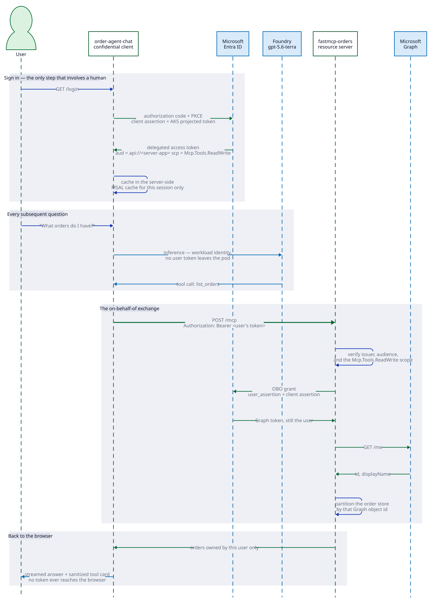

# How the authorization actually works

Read this once and the rest of the repo follows. It is the same in both
deployment modes.

## The thing that trips everyone up

**Microsoft Entra ID is the authorization system. Microsoft Graph is not.**

| | What it is | Where it lives |
|---|---|---|
| **Microsoft Entra ID** | The authorization server. Issues every token. | `login.microsoftonline.com` |
| **Microsoft Graph** | An API. One downstream resource among many. | `graph.microsoft.com` |
| **Azure Databricks** | Another API. Another downstream resource. | `adb-*.azuredatabricks.net` |

Graph gets mistaken for the identity system because it is the API that exposes
directory data — `/me`, users, groups. But as far as tokens are concerned,
**Graph and Databricks are peers**. Neither of them authorizes anything about
the exchange. Entra does.

So when this repo says "OBO to Graph" and "OBO to Databricks", both exchanges
happen at Entra. Only the destination differs.

## Three identities, kept apart

This is the whole security design.

| Identity | Where it lives | What it may do |
|---|---|---|
| **The signed-in user** | A delegated token in the chat pod's per-session MSAL cache | Call the MCP server, and through OBO reach one downstream resource as themselves |
| **The chat workload** | AKS Workload Identity federated to the chat app registration | Sign the client assertion during sign-in, and call Foundry for inference. Holds *no* permission on the MCP server |
| **The MCP workload** | AKS Workload Identity federated to the server app registration | Prove which service it is during the exchange. Holds *no* standing permission to read anyone's data |

Neither workload can reach user data on its own. The MCP server holds only
*delegated* permissions, which are inert without a caller.

That separation is real at the Entra layer and only there. Both pods run in the
`orders` namespace, and Kubernetes has no "may use this ServiceAccount"
permission, so anyone who can create a pod in that namespace can mount the MCP
server's projected token and become the MCP workload as far as Entra is
concerned. Namespace RBAC is what keeps these three apart on the cluster.

The session holding the user's MSAL cache is renewed at sign-in, expires after
30 minutes idle or 8 hours from sign-in, and exists only in that one chat pod's
memory.

## What is actually on the wire

Both modes make the identical request to Entra. One parameter differs:

```http
POST https://login.microsoftonline.com/{tenant}/oauth2/v2.0/token

grant_type            = urn:ietf:params:oauth:grant-type:jwt-bearer
requested_token_use   = on_behalf_of
client_id             = <the MCP server's app id>
client_assertion_type = urn:ietf:params:oauth:client-assertion-type:jwt-bearer
client_assertion      = <the pod's projected Workload Identity token>
assertion             = <the caller's token>
scope                 = <-- the only difference
```

```
graph mode       scope = https://graph.microsoft.com/.default
databricks mode  scope = 2ff814a6-3304-4ab8-85cb-cd0e6f879c1d/.default
```

A mode is named for the resource on that `scope` line, not for where the
decision is made.

Two assertions, two different jobs:

- `client_assertion` answers **"which application is asking?"** It replaces a
  client secret. Entra trusts it because the app registration has a federated
  credential pointing at the AKS OIDC issuer and this pod's service account.
- `assertion` answers **"on whose behalf?"** It is the caller's own token.

That second one is what makes the exchange *delegated* rather than
application-only. Without a caller there is nothing to put there.

`/.default` means "every delegated permission this client has been consented
for that resource", rather than naming scopes one at a time.

In code this is `OboExchange.token(user_assertion, scope)` in
[`src/mcp_server/obo.py`](../src/mcp_server/obo.py). The request above is a handful of arguments; the
rest of that file is a per-caller credential cache and a typed Entra error. No
credential is stored anywhere: the cache holds live credential objects in this
process's memory, keyed by a hash of the caller's own token, dropped a minute
before that token expires and evicted the moment Entra refuses it. So one tool
call is not one round trip to Entra, and a downstream token cannot outlive the
assertion it was minted for. It can outlive a revocation, though: nothing tells
this process that Entra withdrew the caller's token early, so a cached entry
serves until the next refusal evicts it.

## Three gates, three different deciders

Authorization is not one decision. It is three, in three different places.

### Gate 1 — the MCP server admits the call

`AzureJWTVerifier` checks the incoming token's signature, issuer, audience
(`api://<server-app-id>`), and that it carries the `Mcp.Tools.ReadWrite` scope.
A token minted for any other resource is rejected even if it has a scope with
the same name.

No network call to Graph. Signing keys come from Entra's discovery document.

A browser is also held to its `Origin`: everything except `/.well-known/` is
refused unless the origin matches `MCP_SERVER_URL` or one listed in the optional
`MCP_ALLOWED_ORIGINS`, which is what a browser-based MCP client on another
origin would need. Nothing else sends an `Origin`, so nothing else is affected.

### Gate 2 — Entra decides whether to mint the downstream token

This is the exchange itself, and the only gate Entra owns. It checks:

- the caller's token is valid and was issued for this application
- the client assertion proves the app identity, via the federated credential
- **the app holds a delegated permission to the target resource, and it has
  been consented**
- Conditional Access on the caller and on the target resource

That bolded line is the one that matters most here. `infra/main.bicep` requests
`user_impersonation` on Azure Databricks as `type: 'Scope'` — delegated — and
never as `type: 'Role'`, which would be an application permission usable with no
user present. A test compiles the template and asserts every entry is a `Scope`.

Entra evaluates Conditional Access here; this application cannot act on the
answer. A policy demanding a step-up comes back as a claims challenge, and
satisfying one means relaying it: the server would have to answer `401` with a
`WWW-Authenticate` carrying the claims, and the chat client would have to
declare the `cp1` capability so Entra knows it can handle one. Neither is built,
so a step-up is not recoverable inside this app. What is built is the diagnosis.
`OboError` in `src/mcp_server/obo.py` keeps Entra's error code, the AADSTS numbers and the
claims challenge, and reaches the user as a `ToolError` rather than being
flattened by `mask_error_details` into an indistinguishable failure — so
AADSTS50076 reads as the policy it is, and the user satisfies it out of band and
signs in again.

### Gate 3 — the downstream resource decides what the token can do

And this is where the two modes genuinely diverge:

| | graph mode — Microsoft Graph | databricks mode — Azure Databricks |
|---|---|---|
| Checks | Graph's own permission model: `User.Read` lets you read your own profile | Workspace membership, then Unity Catalog grants, row filters and column masks |
| Then what | `src/mcp_server/orders.py` partitions an in-memory dict by the object id Graph returned | Nothing. The rows arrive already filtered |

Gate 3 is the argument for the whole accelerator. In graph mode the
application is the last line of defence, and it is correct only for as long as
every tool remembers to filter. In databricks mode the server could not return
another user's rows if it tried, because it never received them.

## What the token carries

Whichever resource you target, the returned token still identifies **the human**:

| Claim | Value |
|---|---|
| `aud` | The target resource — this is what changes |
| `oid` / `sub` | The original user, unchanged |
| `upn` | The original user |
| `appid` | The MCP server, recording who relayed the request |
| `scp` | The delegated permissions |

The downstream service sees *"this is Ali, relayed by the MCP server"* — not
*"this is the MCP server"*. That is why `current_user()` in a Databricks SQL
warehouse returns a person's UPN, and why the audit log names a human.

## Why a generic MCP client cannot sign in here

The server half of the MCP authorization spec is implemented: `/mcp` serves RFC
9728 protected resource metadata and answers an unauthenticated call with a
`WWW-Authenticate` challenge carrying `resource_metadata`, so a client can
discover which authorization server to go to. It still cannot finish, for two
reasons that belong to Entra rather than to this repo:

- The spec says a client MUST send the RFC 8707 `resource` parameter naming the
  canonical MCP server URI. Entra does not implement resource indicators — the
  audience comes from the scope, which here is
  `api://<server-app-id>/Mcp.Tools.ReadWrite` and can never equal the server's
  URL.
- Entra's OIDC metadata omits `code_challenge_methods_supported`, and the spec
  tells a client that finds it missing to refuse to proceed.

So authorization here works only for clients registered against the server
application in advance: the chat app, and the Azure CLI when
`HARNESS_CLIENT_APP_ID` pre-authorizes it. Point a generic MCP client at `/mcp`
and it fails during discovery, not at the token endpoint.

## Where Graph does legitimately appear

`infra/main.bicep` is full of `Microsoft.Graph/applications` and
`Microsoft.Graph/oauth2PermissionGrants`. That is the Graph API used as the
**management API for Entra** — creating app registrations and writing consent
records.

- **Config time:** the Graph API writes the consent record into the directory.
  Runs once, during `azd provision`.
- **Request time:** Entra reads that record when deciding gate 2. Graph is not
  called.

In databricks mode, Graph is never contacted at runtime at all — and the
template requests no Graph permission and writes no Graph consent record in that
mode either. The delegated `User.Read` exists in graph mode only.

## Reading it in the code

| File | What to look for |
|---|---|
| [`src/mcp_server/obo.py`](../src/mcp_server/obo.py) | The exchange. Both modes call it; only `scope` differs |
| [`src/mcp_server/server.py`](../src/mcp_server/server.py) | Gate 1, and the mode switch |
| [`src/mcp_server/orders.py`](../src/mcp_server/orders.py) | Gate 3 done by the application |
| [`src/mcp_server/databricks.py`](../src/mcp_server/databricks.py) | Gate 3 delegated to Unity Catalog |
| [`infra/main.bicep`](../infra/main.bicep) | The delegated permissions and consent that make gate 2 pass |

The first diagram walks the exchange one message at a time. The second asks what
each credential reaches with no other credential present — its red dashed edges,
crossed at the head, are the paths that do not exist: the chat workload holds no
application permission on order data, and the MCP workload's `/me` resolves
nobody without a caller.




