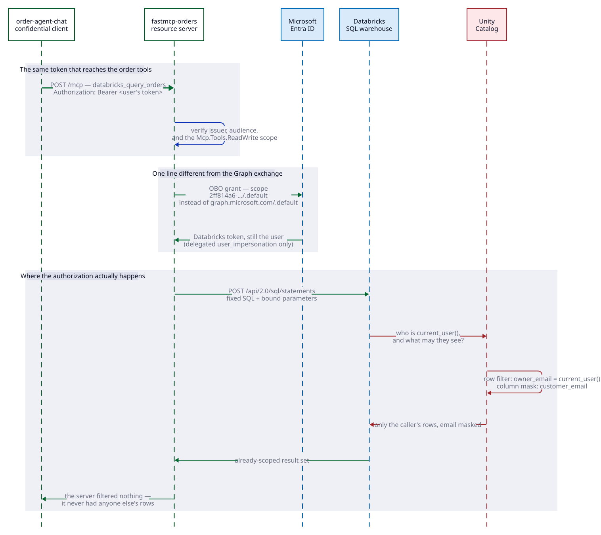

# Databricks mode

**The persona:** your data already lives in a governed platform, and you want an
MCP server that reaches it as the person asking — without becoming the
authorization layer yourself.

Unity Catalog applies the row filter, the column mask and the table grants. The
MCP server sends one fixed statement and gets back rows that are already scoped.



## What changes from orders mode

Two things. Everything else — both app registrations, both federated
credentials, the JWT verification, the exchange itself — is untouched.

| | orders mode | databricks mode |
|---|---|---|
| OBO scope | `https://graph.microsoft.com/.default` | `2ff814a6-…/.default` |
| Who decides what you see | `src/orders.py`, by hand | Unity Catalog |

## What it deploys

The base stack, plus:

- A **premium** Azure Databricks workspace. Premium is not optional — Unity
  Catalog, table ACLs, row filters and column masks are all premium features.
- Delegated `user_impersonation` on Azure Databricks, with tenant-wide consent.

Azure auto-provisions a Unity Catalog metastore with the first workspace in a
region, so **no Databricks account administrator is required**.

## The tools

| Tool | Behaviour |
|---|---|
| `databricks_whoami` | The SCIM `/Me` and SQL `current_user()` identity Databricks resolved |
| `databricks_list_tables` | The demo schema's tables the caller may see |
| `databricks_query_orders` | Queries the Unity Catalog orders table as the caller |

`databricks_query_orders` sends one fixed statement. `region` and `limit` travel
as bound parameters, so no tool argument can reshape the SQL — and if one could,
the row filter would still apply.

## What Unity Catalog enforces

The bootstrap seeds three orders per owner and attaches:

```sql
CREATE FUNCTION orders_row_filter(owner STRING)
RETURNS BOOLEAN RETURN owner = current_user();

ALTER TABLE orders SET ROW FILTER orders_row_filter ON (owner_email);
ALTER TABLE orders ALTER COLUMN customer_email SET MASK mask_email;
```

Owners are you, plus anyone in `DATABRICKS_DEMO_OWNERS`, plus one synthetic
address nobody signs in as — so a default deployment holds six rows across two
owners, and there is always at least one row you cannot see.

The server sends `SELECT … FROM orders` with **no predicate on `owner_email`**
and does no filtering. Exactly your three rows come back, with `customer_email`
reading `***@northwind.example`. The bootstrap writes the real totals to
`DATABRICKS_SEEDED_TOTAL` and `DATABRICKS_SEEDED_PER_OWNER`, and the harness
asserts against those rather than against a number written in this file.

This holds **even for the table owner and a metastore admin**. Table-level row
filters and column masks have no owner bypass, unlike dynamic views where the
owner sees everything. The demonstration stays honest when an administrator runs
it, which is usually who is running it.

## The bootstrap

Bicep stops at the workspace. Metastores are account-level, and catalogs,
warehouses, tables, grants, filters and masks are all Databricks REST or SQL. A
`postprovision` hook runs `scripts/bootstrap_databricks.py`, which is idempotent
and the only imperative step in the deployment.

```bash
uv run python -m scripts.bootstrap_databricks            # the demo
uv run python -m scripts.bootstrap_databricks --no-seed  # platform only
```

`--no-seed` provisions the catalog, schema and warehouse without the sample
orders, filters and grants. That is the starting point for pointing the server
at real data: change `orders_statement` in `src/databricks.py`, set
`DATABRICKS_CATALOG` and `DATABRICKS_SCHEMA`, and keep the statement a fixed
literal with bound parameters.

It also creates a 2X-Small serverless SQL warehouse with a ten-minute auto-stop,
falling back to a classic PRO warehouse where serverless is unavailable.

## Two people, one query, different rows

Set this before provisioning and the bootstrap seeds three orders for each named
sign-in alongside the operator's own:

```bash
azd env set DATABRICKS_DEMO_OWNERS "someone@contoso.com,someone-else@contoso.com"
```

Each person then asks the same question and sees only their own rows, and
`databricks_whoami` names them individually. The server ran identical SQL every
time. That is the demonstration worth showing a customer, because the isolation
is visibly not the application's doing.

## Verifying it

```bash
uv run python -m unittest test_databricks_e2e -v
```

Runs against the real deployment and asserts that SCIM and SQL `current_user()`
both name the signed-in human; that a query with no owner predicate returns
strictly fewer rows than were seeded; that `customer_email` is masked; that a
bound parameter narrows without touching the SQL; that the server application
holds no `Role` permission; and that an unauthenticated `/mcp` call gets a 401.

It needs a delegated token, which it gets from `az account get-access-token`.
That works only when `harnessClientAppId` pre-authorizes the Azure CLI on the
server application. It is **empty by default** — turn it on deliberately:

```bash
azd env set HARNESS_CLIENT_APP_ID 04b07795-8ddb-461a-bbee-02f9e1bf7b46
```

Nothing in the running system depends on it. Unset it and the harness skips.

## Things that will bite you

**`Unauthorized access to Org`** — a valid Entra token is not enough on its own;
the identity must also exist inside the workspace, and a new workspace only
knows whoever created it. The bootstrap works around this by sending an ARM
management token alongside the Databricks token:

```
X-Databricks-Azure-SP-Management-Token: <token for management.core.windows.net>
X-Databricks-Azure-Workspace-Resource-Id: <the workspace ARM resource id>
```

Anyone holding Owner or Contributor on the workspace resource is then treated as
a workspace admin and provisioned on first call. The same requirement applies to
**end users**: someone who has never signed in to Databricks cannot be resolved
by the MCP tools either. Provision them through SCIM from Entra, or have them
open the workspace once.

**`PERMISSION_DENIED … CREATE FUNCTION` on a second run** — Unity Catalog
privileges are independent of workspace admin. A schema created by one operator
cannot be rebuilt by another until ownership moves, so the bootstrap issues
`ALTER SCHEMA … OWNER TO` before touching anything inside it.

**`INVALID_STATE: Metastore storage root URL does not exist`** — expected on a
workspace whose metastore was auto-provisioned. It has no storage root, so
`CREATE CATALOG` needs an explicit location. The bootstrap falls back to the
managed catalog Azure created with the workspace and reports the name it used.
Nothing to fix.

**The OBO exchange is rejected** — the server application is missing the
delegated `user_impersonation` permission or its consent. Activate an Entra
application-management role, then `az login` again before re-running
`azd provision`. Directory roles travel inside the access token, so a login
issued before the role was activated will not carry it no matter how long you
wait.

**`azd provision --preview` shows no Databricks workspace** — ARM what-if has no
coverage for the `Microsoft.Databricks` provider, so it silently omits those
resources rather than reporting them as unchanged. Confirm with
`az bicep build` instead.

## Customer-managed catalog storage

The template uses Databricks Default Storage, which needs no storage account, no
Access Connector and no Unity Catalog storage credential. If governance requires
the catalog to sit in storage you own, add an ADLS Gen2 account with
hierarchical namespace, a `Microsoft.Databricks/accessConnectors` resource, and a
storage credential plus external location, then create the catalog with
`MANAGED LOCATION`.

Two role assignments are easy to miss and both produce unhelpful errors:

| Role | Assigned to | Scope | Failure without it |
|---|---|---|---|
| Storage Blob Data Contributor | The connector's managed identity | The storage account | Unity Catalog cannot read or write table data |
| Reader | The connector's managed identity | **The connector itself** | `UC_CREDENTIAL_MI_IS_MISSING_READER_ROLE` |

The principal registering the credential also needs Contributor or Owner
directly on the Access Connector; inherited subscription Owner is not always
sufficient, and the failure reads `UC_CREDENTIAL_INVALID_CLOUD_PERMISSIONS`.
